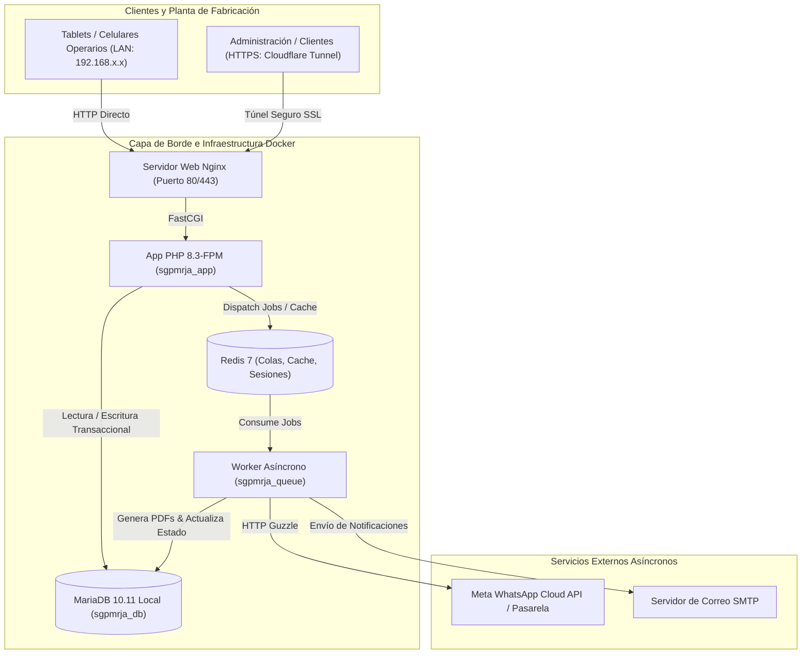
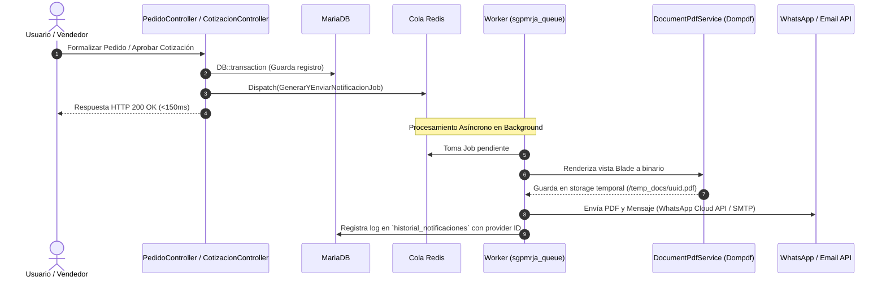

# INFORME TÉCNICO DE ARQUITECTURA Y ESCALABILIDAD — SGPMRJA
**Sistema de Gestión de Producción — Creaciones Atlántico C.A.**  
**Documento para el Equipo de Proyecto:** Emmanuel (Tech Lead) · Vanessa (Frontend / Maestros) · Santiago (Backend / Transacciones)  
**Fecha de Emisión:** Octubre 2026 | **Versión:** 2.0-STABLE  
**Entorno Técnico:** Laravel 13.x (PHP 8.3+) · React 19 / Inertia · MariaDB 10.11 · Redis 7 · Docker  

---

## 1. Resumen Ejecutivo y Dashboard de Salud del Sistema

Este informe consolida la auditoría técnica profunda del repositorio y establece el plano maestro de arquitectura para la implementación de **4 nuevos módulos industriales** (Control de Bordado, Calculadora de Insumos/BOM, Control de Producción a Destajo y Despacho Asíncrono por WhatsApp/Email), acompañado de la estrategia de infraestructura Docker, redes y QA.

### 1.1 Matriz de Diagnóstico y Estado Actual

| Dominio | Estado Actual | Deuda Técnica Detectada | Impacto | Acción Arquitectónica |
|---|---|---|---|---|
| **Controladores** | Funcionales pero sobrecargados | `OrdenProduccionController` >1.300 líneas | Alto (Riesgo de regresiones) | Desacoplar a *Domain Services* y *FormRequests* |
| **ORM / Eloquent** | Relaciones completas | N+1 en accessors (`Producto`, `Pedido`) | Medio (Degradación de latencia) | Caching de relaciones en memoria y *eager loading* forzado |
| **Producción** | Avances acumulados en pivote | Pérdida de log histórico de trabajo diario | Crítico (Impide pago a destajo y auditoría) | Nueva entidad `registro_produccion_operario` |
| **Generación PDF** | `barryvdh/laravel-dompdf` síncrono | Bloqueo de 2 a 4 seg del hilo HTTP | Crítico (Saturación PHP-FPM) | `GenerarDocumentoPdfJob` en colas Redis |
| **Comunicaciones** | Sin pasarelas automáticas | Envío manual de cotizaciones y pedidos | Medio (Fricción comercial) | Canal desacoplado `WhatsAppChannel` + Mail |
| **Base de Datos** | MySQL/MariaDB compatible | Consultas dependientes de funciones MySQL | Alto si se migra a Postgres | Mantener MariaDB local en Docker (<1ms RTT) |

---

## 2. Diagrama General de Arquitectura del Sistema



---

## 3. Especificación Técnica de los 4 Nuevos Módulos

```mermaid
classDiagram
    class Pedido {
        +int id
        +string estado
        +decimal total
        +decimal abono
    }
    class DetallePedido {
        +int id
        +int cantidad
        +bool lleva_bordado
    }
    class DetallePedidoBordado {
        +int id
        +int ubicacion_bordado_id
        +int logo_id
        +decimal precio_aplicado
    }
    class ServicioBordado {
        +string codigo_servicio
        +BordadoEstadoEnum estado
        +int numero_puntadas
        +json colores_hilos
        +string tipo_bastidor
        +decimal costo_adicional_usd
        +decimal costo_adicional_bs
        +transicionarEstado()
    }
    class RecetaProducto {
        +string nombre
        +int version
        +bool activo
    }
    class RecetaInsumo {
        +decimal cantidad_base
        +decimal factor_merma
        +string etapa
    }
    class Insumo {
        +string codigo
        +string nombre
        +decimal stock_actual
        +decimal stock_minimo
    }
    class RegistroProduccionOperario {
        +date fecha_produccion
        +string etapa
        +int piezas_completadas
        +int piezas_defectuosas
        +decimal tarifa_unitario_destajo
        +decimal total_pago_destajo
    }
    class Empleado {
        +int id
        +string nombre
    }

    Pedido "1" --> "*" DetallePedido
    DetallePedido "1" --> "*" DetallePedidoBordado
    DetallePedidoBordado "1" --> "1" ServicioBordado
    RecetaProducto "1" --> "*" RecetaInsumo
    RecetaInsumo "*" --> "1" Insumo
    RegistroProduccionOperario "*" --> "1" Empleado
    RegistroProduccionOperario "*" --> "1" ServicioBordado
```



---

### Módulo 1: Control de Servicio de Bordado Técnico
- **Objetivo:** Transformar la personalización de prendas de un mero registro contable en una ficha de producción industrial.
- **Entidad Principal:** `servicio_bordado` (migración con FKs a `detalle_pedido_bordado`, `sub_orden_produccion`, `logo` y `bordado_ubicacion`).
- **Máquina de Estados (`BordadoEstadoEnum`):**
  ```mermaid
  stateDiagram-v2
      [*] --> PendienteMatriceria: Creación desde Línea
      PendienteMatriceria --> MatrizAprobada: Digitalizador aprueba ponchado (.DST)
      MatrizAprobada --> EnCola: Asignado a máquina
      EnCola --> EnBordado: Montaje en bastidor
      EnBordado --> ControlCalidad: Finalización de puntadas
      ControlCalidad --> Completado: Aprobado sin defectos
      ControlCalidad --> EnBordado: Rechazado (Desmanche / Reproceso)
      PendienteMatriceria --> Cancelado: Cancelación del Pedido
      EnCola --> Cancelado: Cancelación del Pedido
  ```
- **Integración Multimoneda:** Congela el snapshot de `TasaCambio::tasaVigente()` guardando `costo_adicional_usd`, `costo_adicional_bs` y `tasa_cambio_aplicada`.

---

### Módulo 2: Calculadora de Insumos basada en Catálogo (BOM / Recetas)
- **Objetivo:** Proyectar con precisión milimétrica la materia prima (telas, hilos, entretelas, botones) requerida para fabricar cualquier combinación del catálogo.
- **Fórmula de Consumo con Factor de Merma Industrial:**
  $$\text{Consumo Total} = \sum \left[ \text{Unidades} \times \left( \text{Cantidad Base} \times \left(1 + \frac{\text{Factor Merma}}{100}\right) \right) \right]$$
- **Servicio:** `App\Services\InsumoCalculatorService`.
  - Carga el BOM completo en una única consulta optimizada (*zero N+1*).
  - Compara en memoria contra `insumo.stock_actual` sin bloquear filas de la base de datos.
  - Clasifica cada insumo en:
    - 🟢 **`ok`**: Stock suficiente sin comprometer mínimos.
    - 🟡 **`ajustado`**: Hay material pero dejará el inventario por debajo del `stock_minimo`.
    - 🔴 **`falta`**: Déficit de materia prima. Genera automáticamente el payload para prellenar la orden de compra en el módulo de proveedores.

---

### Módulo 3: Control y Registro de Producción por Trabajador (Destajo y Reportes)
- **Objetivo:** Restituir la trazabilidad temporal del taller eliminada en migraciones previas, permitiendo calcular el pago a destajo por operario y generar reportes dinámicos de rendimiento.
- **Entidad:** `registro_produccion_operario`.
- **Estrategia Anti-Bloqueo de Base de Datos:**
  - Las transacciones de registro utilizan `lockForUpdate` únicamente sobre la fila específica de la orden y la cuota del empleado en el pivot.
  - Para los reportes dinámicos, `ProduccionReporteService` ejecuta consultas de agregación puras mediante Query Builder con índices compuestos dedicados:
    1. `idx_prod_emp_fecha (empleado_id, fecha_produccion, etapa)`
    2. `idx_prod_orden_etapa (orden_produccion_id, etapa)`
    3. `idx_prod_calidad (etapa, piezas_defectuosas, fecha_produccion)`

---

### Módulo 4: Envío Asíncrono de Reportes y Notificaciones (WhatsApp & Email)
- **Objetivo:** Eliminar por completo el tiempo de espera del usuario al generar facturas, cotizaciones y reportes.



---

## 4. Estrategia de Infraestructura y Redes (DevOps)

### 4.1 Veredicto de Base de Datos: Motor Local vs Supabase (PostgreSQL)

> [!CAUTION]
> **Decisión Definitiva:** **Conservar MariaDB 10.11 / MySQL en Docker local.**
> 
> **Razones Técnicas:**
> 1. **Incompatibilidad de Sintaxis:** Consultas actuales en `OrdenProduccionController` y `ReportesController` usan `IF()`, `SUM(condicion_booleana)` y `YEAR()/MONTH()`, las cuales colapsan con errores fatales en PostgreSQL.
> 2. **Latencia Operativa Crítica:** El taller opera con operarios registrando piezas desde tablets. Una base de datos en la nube (Supabase) introduce entre 80 ms y 200 ms de latencia por petición; en operaciones con bloqueos pesimistas (`lockForUpdate`), el tiempo de espera aumenta hasta 1000 ms, degradando la experiencia en planta. En Docker local la latencia es **< 1 ms**.
> 3. **Supervivencia Offline:** Si se interrumpe la conexión a internet en la fábrica, el sistema en Docker local continúa operando sin detener las líneas de costura ni el corte.

---

### 4.2 Arquitectura de Acceso Multi-dispositivo (LAN + Remoto)

Para que las tablets de la planta (`192.168.1.x`) y la directiva vía Cloudflare Tunnel (`https://sgpmrja.miempresa.com`) convivan sin errores de CORS, redirecciones infinitas ni estilos rotos:

1. **Proxy Confiable Universal:**  
   En `app/Http/Middleware/TrustProxies.php`:
   ```php
   protected $proxies = '*';
   ```
2. **Cookies y Sesiones Flexibles:**  
   En `.env`:
   ```dotenv
   SESSION_DOMAIN=null
   SESSION_SECURE_COOKIE=false
   ASSET_URL=null
   ```
3. **Compilación de Assets con Vite:**  
   Los assets se compilan en tiempo de construcción (`npm run build`) generando URLs relativas (`/build/...`). Esto garantiza que la interfaz cargue idéntica sin importar la IP o el dominio utilizado.

---

## 5. Plan de Testing Automatizado (QA)

| Tipo de Prueba | Archivo de Test | Alcance Crítico | Simulación (*Fakes*) |
|---|---|---|---|
| **Unit** | `InsumoCalculatorServiceTest` | Cálculo de mermas, escalado por tallas y clasificación de stock. | Datos en memoria / Factories |
| **Unit** | `BordadoServiceTest` | Transiciones válidas e inválidas de la máquina de estados. | Enums tipados |
| **Feature** | `RegistroProduccionOperarioTest` | Control de concurrencia y validación de que nadie registre más unidades de las asignadas. | `RefreshDatabase` + Locks |
| **Feature** | `ReporteEficienciaTest` | Comprobación de que las consultas de agregación SQL corren en < 50ms sin N+1. | Benchmarking de queries |
| **Feature** | `DespachoAsincronoTest` | Verificación de que la aprobación no bloquea HTTP y los jobs se encolan. | `Event::fake()`, `Queue::fake()` |
| **Feature** | `WhatsAppChannelTest` | Envío de payload JSON a Meta API y registro en `historial_notificaciones`. | `Http::fake()` |

---

## 6. Asignación de Roles y Roadmap de Implementación

Con base en los roles definidos en `AGENTS.md`:

```
SPRINT 1: Infraestructura & Insumos (BOM)
├── Emmanuel: Dockerización (Dockerfile multistage + compose + Redis)
├── Vanessa:  CRUD y UI de Recetas/BOM en Catálogo de Productos
└── Santiago: Migraciones `receta_*` + `InsumoCalculatorService` + Tests

SPRINT 2: Servicio de Bordado Técnico
├── Vanessa:  Vistas de fichas de bordado, matrices y bastidores
└── Santiago: Migración `servicio_bordado` + `BordadoService` + State Machine

SPRINT 3: Registro de Producción por Trabajador & Reportes
├── Santiago: Migración `registro_produccion_operario` + Refactor `OrdenProduccionController`
├── Emmanuel: `ProduccionReporteService` con agregaciones SQL indexadas
└── Vanessa:  UI de registro rápido en tablets para operarios + DataTables de eficiencia

SPRINT 4: Notificaciones Asíncronas (WhatsApp & Email)
├── Emmanuel: Configuración de Worker Redis + `DocumentPdfService` en background
└── Santiago: `WhatsAppChannel` + `MetaWhatsAppCloudService` + Jobs & Listeners
```

---
*Reporte generado y archivado automáticamente para control interno del equipo de desarrollo de Creaciones Atlántico C.A.*
